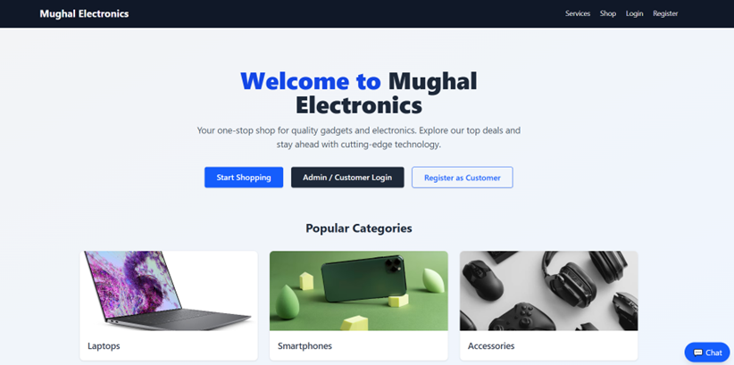
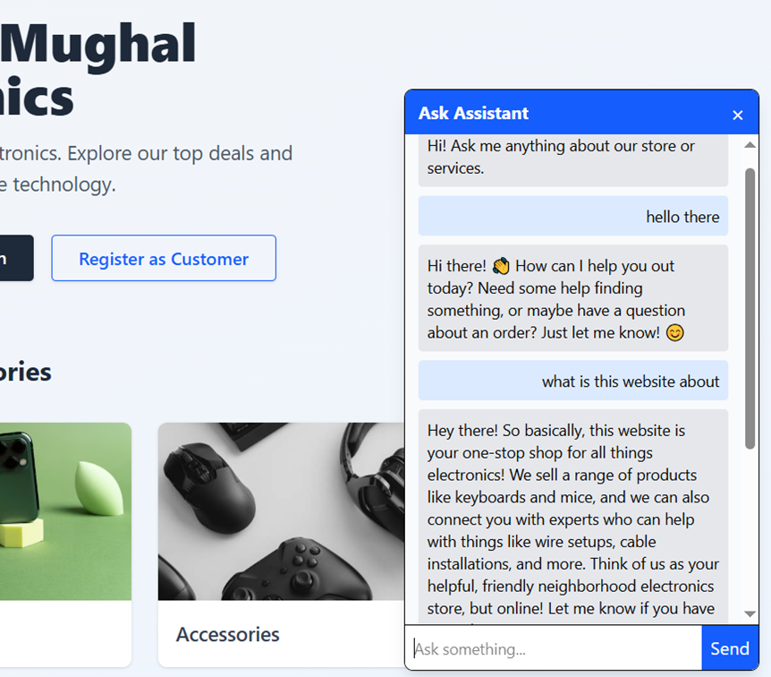
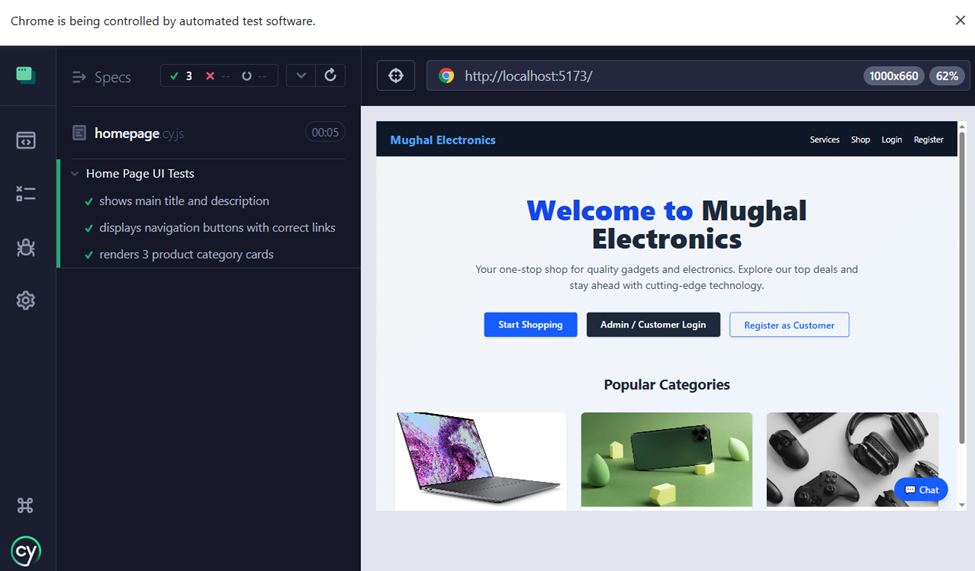
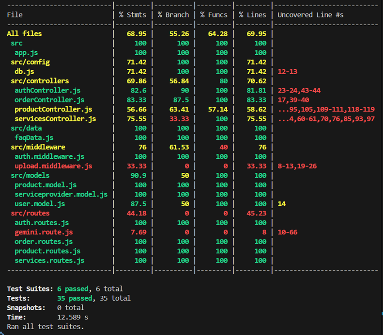
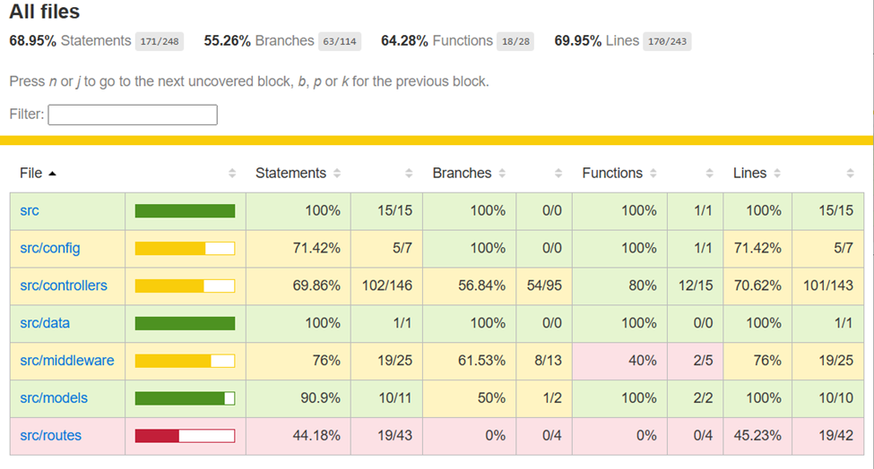

# Electronics Retail Store (MERN Stack)

A comprehensive full-stack e-commerce application built with the MERN stack (MongoDB, Express.js, React, Node.js). This platform provides a robust shopping experience for electronic products, featuring user authentication, product management, an integrated chatbot, and comprehensive testing suites.

## Technologies Used

### Frontend
- **Framework**: React 19 + Vite
- **Styling**: TailwindCSS
- **Routing**: React Router DOM
- **HTTP Client**: Axios
- **E2E Testing**: Cypress

### Backend
- **Environment**: Node.js
- **Framework**: Express.js
- **Database**: MongoDB with Mongoose
- **Authentication**: JSON Web Tokens (JWT) & bcrypt
- **File Uploads**: Multer
- **Unit/Integration Testing**: Jest, Supertest, MongoDB Memory Server

---

## Features

- **User Authentication**: Secure user registration and login using JWT and bcrypt password hashing.
- **Product Management**: Browse, view details, and manage electronic products.
- **Smart Chatbot**: Integrated AI chatbot to assist users with their shopping experience.
- **File Uploads**: Secure image and media handling with Multer.
- **Comprehensive Testing**: 
  - Backend API coverage via **Jest** and **Supertest**.
  - Frontend E2E user flows covered by **Cypress**.

---

## Technical Highlights

### Store Chatbot
The application has a customer support chatbot. To make sure the bot gives correct answers about the store, the backend fetches the latest products, services, and FAQs from the database and includes them in the request. This helps the bot answer questions using actual store data.

### Testing Setup
The project includes tests for both the frontend and backend:
- **Backend Testing**: API routes and logic are covered by unit and integration tests. These tests use an in-memory database so they run quickly and don't modify the real development database.
- **Frontend Testing**: Automated browser tests verify that the main user flows and screens work correctly.

---

## Gallery & Testing

### Home Page
A modern, responsive storefront built with TailwindCSS.
<p align="center">
  
</p>

### Chatbot Interface
Interactive assistant to help users navigate the store.
<p align="center">
  
</p>

### End-to-End Testing (Cypress)
Automated UI testing to ensure reliable user journeys.
<p align="center">
  
</p>

### Unit & Integration Testing (Jest)
Robust backend API testing ensuring data integrity and security.
<p align="center">
  
</p>
<p align="center">
  
</p>

---

## Installation & Setup

### Prerequisites
- Node.js (v18+ recommended)
- MongoDB (Local or Atlas URI)
- pnpm / npm / yarn

### 1. Clone the Repository
```bash
git clone <repository-url>
cd electronics-store-mern
```

### 2. Backend Setup
```bash
cd backend
npm install
# Create a .env file and add your configuration (MONGO_URI, JWT_SECRET, PORT, etc.)
npm run dev
```

### 3. Frontend Setup
```bash
cd frontend
npm install
# Configure frontend environment variables if needed
npm run dev
```

---

## Available Scripts

### Backend (`/backend`)
- `npm start`: Starts the production server.
- `npm run dev`: Starts the development server with Nodemon.
- `npm test`: Runs the Jest test suite with coverage.

### Frontend (`/frontend`)
- `npm run dev`: Starts the Vite development server.
- `npm run build`: Builds the app for production.
- `npm run preview`: Previews the production build locally.
- `npm run lint`: Runs ESLint code checks.
